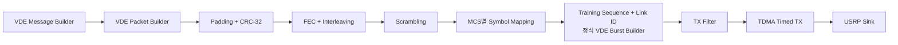
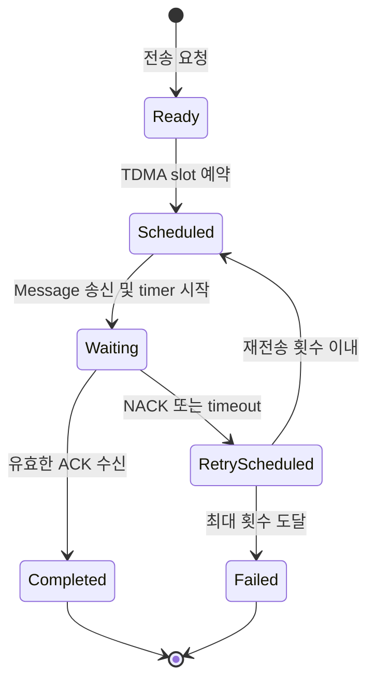
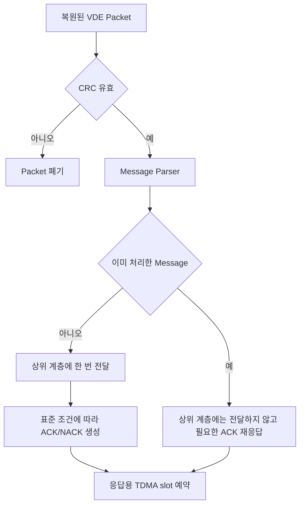

# VDE-TER 후속 단계 구현 계획

> 2단계 링크 계층 구현과 별도 `error-correction` 브랜치의 Turbo FEC를 결합하고, 이후 정식 VDE-TER PHY와 MAC으로 확장하기 위한 계획을 정리한 문서입니다.

| 항목        | 내용                                                                                    |
| ----------- | --------------------------------------------------------------------------------------- |
| 문서 목적   | 2단계 링크 계층 구현 완료 후 정식 VDE-TER PHY/MAC으로 전환하기 위한 별도 구현 범위 정의 |
| 시작 기준선 | Type 92/93 Message 및 Packet Builder/Parser, Temporary Burst, 기존 BPSK PHY 송수신 완료 |
| 적용 시점   | `requirements.md`의 2단계 예상 결과를 충족한 이후                                       |
| 표준 기준   | 구현 착수 시 채택할 VDE-TER 표준 판본에서 파라미터와 bit layout을 확정                  |
| 통합 대상   | `no-error-correction` 브랜치와 `error-correction` 브랜치                                |

## 1. 후속 구현 범위

다음 항목은 현재 2단계 구현에 포함하지 않고 후속 단계에서 구현한다.

- VDE Packet Padding과 CRC-32 생성·검증
- FEC encoding/decoding과 interleaving/deinterleaving
- Scrambling/Descrambling
- MCS 선택과 MCS별 변조·복조
- π/4-QPSK, 8PSK, 16QAM symbol mapping/demapping
- 정식 Training Sequence 생성과 검출
- Link ID 생성, encoding, decoding
- 정식 VDE Burst 조립, 검출, 동기 및 해체
- TDMA slot 선택, 예약 및 timed transmission
- ACK/NACK 제어 Message와 timeout 기반 재전송, 중복 수신 억제 및 재전송 종료 처리

## 2. 전환 원칙

- Type별 Message codec과 VDE Packet Builder/Parser는 유지한다.
- 7장의 B210 통합 실험에서는 시험용 `F9A8`과 `Temporary Packet Length`를 유지하고, 정식 PHY 전환 시 Burst 계층에서 제거한다.
- Message codec에 CRC, FEC, Scrambling, MCS 또는 TDMA 처리를 넣지 않는다.
- GNU Radio의 범용 DSP 블록을 활용하되 VDE 전용 polynomial, seed, code, mapping과 적용 범위는 표준에 따라 직접 설정한다.
- 한 단계씩 교체하고 각 단계의 입력·출력 경계를 독립적으로 확인한다.

## 3. 최종 송신 처리 구조



## 4. 최종 수신 처리 구조

```mermaid
flowchart LR
    USRP["USRP Source"] --> RX["RX Filter · Timing · Carrier Recovery"]
    RX --> DETECT["Training Sequence Detector<br/>Burst Synchronizer"]
    DETECT --> LINK["Link ID Decoder"]
    LINK --> DEMAP["MCS별 Symbol Demapping"]
    DEMAP --> DESCR["Descrambling"]
    DESCR --> FEC["Deinterleaving + FEC Decoding"]
    FEC --> CRC["CRC-32 확인 + Padding 제거"]
    CRC --> PKT["VDE Packet Parser"]
    PKT --> MSG["Registry + Type별 Message Decoder"]
```



Link ID를 먼저 해석하여 수집할 Packet 크기와 MCS를 결정한다. 이후 해당 설정으로 Payload를 복조하고 역처리를 거쳐 VDE Packet을 복원한다.

## 5. GNU Radio 활용과 직접 구현 구분

| 기능              | GNU Radio 활용 가능 부분         | VDE 전용으로 확정·구현할 부분                     |
| ----------------- | -------------------------------- | ------------------------------------------------- |
| CRC-32            | 일반 CRC 블록 또는 함수          | polynomial, init/xor/reflection, 적용 범위와 위치 |
| FEC               | FEC framework와 codec 인터페이스 | VDE code, puncturing, interleaving, 파라미터      |
| Scrambling        | Scrambler/Descrambler            | polynomial, seed, reset 시점, 적용 범위           |
| 변조              | PSK/QAM constellation 도구       | VDE mapping, 회전, MCS 연동                       |
| Training Sequence | sequence 처리 도구               | 정식 sequence와 삽입·검출 위치                    |
| Link ID           | 범용 bit 처리 도구               | 필드 생성, encoding, decoding, MCS/길이 해석      |
| Burst             | stream, tag, PDU 도구            | 정식 조립 순서, 경계와 동기 규칙                  |
| TDMA              | UHD timed command와 tag          | slot 선택, 예약, 절대시간 송신 정책               |

## 6. 제안 모듈 경계

```text
vdeter_link/                  # 현재 2단계 링크 계층 패키지 유지
├─ messages/                  # Type별 Message codec
├─ packet/                    # Packet Builder/Parser
├─ burst/                     # 시험용 Temporary Burst
└─ adapters/                  # 현재 GNU Radio 연결

vdeter_phy/                   # 후속 정식 PHY 패키지
├─ crc.py
├─ fec.py
├─ scrambling.py
├─ modulation.py
└─ burst/
   ├─ vde_builder.py          # 정식 Training/Link ID/Burst 조립
   └─ vde_receiver.py         # Burst 검출·동기·Link ID·Payload 추출

vdeter_mac/                   # 후속 MAC 패키지
└─ tdma.py
```

세부 파일 구성은 실제 표준 파라미터와 GNU Radio 블록 적용 방식을 확정한 후 조정한다.

## 7. B210 유선 환경의 Padding·CRC·Turbo FEC 통합 실험

이 단계의 목표는 정식 VDE-TER PHY 전체를 구현하는 것이 아니라, 현재 코드를 최대한 유지하면서 표준 Packet Padding과 CRC-32를 추가하고 Link ID 11용 Turbo FEC 코드를 결합하여 유선 환경의 Payload 깨짐이 줄어드는지 확인하는 것이다. 두 대의 USRP B210을 적절한 감쇠기를 포함한 유선 환경으로 연결해 반복 송수신한다.

### 7.1 유지할 부분과 추가할 부분

| 그대로 유지할 부분                                  | 이번 실험에서 추가·변경할 부분            |
| --------------------------------------------------- | ----------------------------------------- |
| Type 92/93 codec, registry와 터미널 Payload 입력    | Type 81 Padding byte codec                |
| 단일·다중 Message 입력과 반복 횟수                  | Link ID 11용 54-byte 고정 Packet 구성     |
| F9A8 Correlator와 Temporary Packet Length           | 표준 CRC-32 생성·검증                     |
| Temporary Burst Builder/Extractor                   | `bytes ↔ unpacked bits ↔ FEC PDU` adapter |
| 현재 BPSK 변조·복조, RRC, Symbol Sync와 Costas Loop | 기존 Turbo Encoder/Decoder 연결           |
| 현재 TX/RX GNU Radio adapter와 콘솔 출력            | FEC 전후 bit 오류와 CRC 결과 표시         |

이번 실험에서는 정식 Training Sequence, Link ID coding, Scrambling, π/4-QPSK, 다른 MCS, 정식 Burst 및 TDMA를 추가하지 않는다. 이 기능들은 현재 B210 유선 통합 결과를 확인한 뒤 후속 단계에서 구현한다.

### 7.2 최소 코드 변경 범위

| 구분    | 입력                                                      | 출력                                    | 비고                                            |
| ------- | --------------------------------------------------------- | --------------------------------------- | ----------------------------------------------- |
| Encoder | PMT `u8vector` PDU, unpacked bit `432`개                  | PMT `u8vector` PDU, coded bit `874`개   | Link ID 11, Turbo rate 1/2와 10개 tail bit 포함 |
| Decoder | PMT `u8vector` hard bit 또는 `f32vector` soft LLR `874`개 | PMT `u8vector` PDU, decoded bit `432`개 | 기본 6 iterations                               |

PDU는 GNU Radio 내부에서 하나의 완성된 bit 묶음을 전달하기 위한 형식이며 RF로 전송되는 별도 헤더가 아니다. Turbo FEC 코드는 CRC, Type 81 Padding, byte-bit 변환, Scrambling, Link ID coding, 변조 및 Burst 처리를 담당하지 않는다.

기존 Turbo Encoder/Decoder의 알고리즘은 재작성하지 않고 공개 함수 또는 PDU 입·출력 경계를 통해 호출한다. 기존 링크 계층에는 다음 연결부만 추가한다.

```text
messages/type_81.py            # 1-byte Padding Message
packet/builder.py              # Message(s) 뒤를 Type 81로 채워 CRC 전 50 bytes 구성
crc.py                         # CRC-32를 붙여 총 54 bytes 구성·검증
fec/adapter.py                 # 54 bytes ↔ 432 bits ↔ Encoder/Decoder PDU
adapters/gnuradio_tx.py        # Packet Builder 뒤, Temporary Burst 앞에서 FEC 호출
adapters/gnuradio_rx.py        # Temporary Burst 추출 뒤, Packet Parser 앞에서 FEC/CRC 호출
```

현재 Temporary Burst Builder/Extractor와 GRC의 DSP 블록 연결은 유지한다. TX/RX adapter 내부의 호출 순서만 바꿔 기존 코드에 FEC 구간을 삽입한다.

### 7.3 B210 유선 통합 파이프라인

Link ID 11의 FEC 정보 블록은 432 bit, 즉 54 byte다. Packet Builder는 `Message(s) + Type 81 Padding + CRC-32`를 정확히 54 byte로 구성하고 Turbo Encoder는 이를 874 coded bit로 변환한다.

현재 Temporary Burst는 byte 단위 Payload 길이를 사용하므로 874 bit를 그대로 담을 수 없다. 이번 시험에서만 Encoder 출력 뒤에 6개의 temporary packing bit를 추가하여 880 bit, 즉 110 byte로 묶는다. 수신부는 Temporary Burst에서 110 byte를 복원한 직후 마지막 6 bit를 제거하고 정확히 874 bit만 Turbo Decoder에 전달한다. 이 6 bit는 표준 Type 81 Padding이나 FEC tail이 아니며 현재 byte 기반 Temporary Burst를 유지하기 위한 시험용 정렬값이다.


F9A8, Temporary Packet Length, 기존 BPSK 변조·복조와 GRC block 설정은 변경하지 않는다. FEC는 F9A8과 Temporary Packet Length가 아닌 54-byte VDE Packet에만 적용한다.

### 7.4 실험 방법과 확인 내용

유선 실험 전에 `54 bytes → 432 bits → 874 bits → 432 bits → 54 bytes` software roundtrip을 한 번 실행하여 Padding, CRC와 FEC adapter 연결 자체에 문제가 없는지만 확인한다. 주 실험은 두 대의 B210을 연결한 현재 TX/RX GRC에서 수행한다.

1. 현재 `no-error-correction` 코드로 같은 Payload를 반복 송신하여 기존 Payload 복원 횟수를 기록한다.
2. Padding과 CRC만 추가한 경로로 같은 Payload와 반복 횟수를 송신한다.
3. Padding, CRC와 Turbo FEC를 모두 추가한 경로로 동일하게 송신한다.
4. 각 경로에서 단일 Message와 다중 Message를 각각 사용한다.
5. gain, 감쇠량과 현재 GRC의 DSP 설정은 비교 중 동일하게 유지한다.

다음 값을 간단한 counter나 로그로 확인한다.

- 송신한 Temporary Burst 수
- F9A8 검출 수와 Temporary Packet Length 추출 성공 수
- 수신한 874 coded bit 중 TX Encoder 출력과 다른 pre-FEC bit 수
- Turbo Decoder 이후 원본 432 bit와 다른 post-FEC bit 수
- CRC 통과·실패 수
- Packet Parser 성공 수와 원본 Payload 일치 수
- UHD underflow/overflow 발생 여부

판단은 다음처럼 구분한다.

- 수신 874 bit에 오류가 있어도 Decoder 이후 432 bit가 복원되고 CRC가 통과하면 Turbo FEC가 현재 유선 bit 오류를 보완한 것이다.
- Decoder 이후에도 bit 오류가 남으면 CRC가 실패해야 하며 해당 Packet은 Parser와 Payload Console로 전달하지 않는다.
- F9A8을 검출하지 못하거나 Temporary Packet Length가 깨지면 FEC Payload 자체를 수집할 수 없으므로 Turbo FEC로 해결할 수 없다.
- bit 삽입·누락, 지속적인 timing/carrier 동기 실패, clipping 또는 UHD underflow/overflow가 원인이면 현재 BPSK PHY와 스트리밍 설정을 먼저 조정한다.

이번 단계의 결과는 정식 VDE-TER PHY 적합성 판정이 아니다. 기존 유선환경에서 동일 Payload를 반복 전송했을 때 CRC로 손상 Packet을 걸러내고, Turbo FEC 적용 후 정상 Payload 복원 비율이 기존보다 개선되는지 확인하는 데 한정한다.

## 8. 개발을 위해 정리할 지식 목록

추후 작성 예정

## 9. 그 외 구현 계획 (논의 필요)

7장의 Link ID 11 기반 링크 계층·Turbo FEC 통합 이후에는 모든 Link ID와 Message Type을 한꺼번에 구현하지 않는다. 실제 송수신 시나리오를 하나씩 완성하는 데 필요한 기능 묶음을 우선 구현하고, 나머지는 profile과 registry를 추가하는 방식으로 확장한다.

**단계별 구현 순서**

| 단계 | 구현 목표 |
| --- | --- |
| 1차 | B210 유선 환경에서 Type 81 Padding, CRC-32 및 Link ID 11 Turbo FEC 통합 |
| 2차 | Training Sequence, Link ID coding, Scrambling과 π/4-QPSK를 포함한 정식 Link ID 11 PHY |
| 3차 | Type 13 ACK/NACK, Type 92 재전송, timeout 및 중복 수신 처리 |
| 4차 | Type 90 Resource Request와 Type 4 Resource Allocation을 이용한 자원 할당 |
| 5차 | Type 74~76 Fragmentation/Reassembly와 다중 slot Data Session |
| 6차 | TDMA, logical channel 및 제어국 운용 기능 |
| 7차 | 실제 운용 요구에 따른 다른 Link ID, MCS 및 Message Type 확장 |

### 9.1 Link ID와 MCS 지원 범위

첫 정식 PHY 목표는 **Link ID 11 한 개를 완성하는 것**으로 제한한다. Link ID 11에서 Packet, CRC-32, Turbo FEC, Scrambling, π/4-QPSK, Training Sequence, Link ID coding 및 한 slot Burst 송수신을 먼저 연결한다.

다른 Link ID는 다음 기준으로 추가한다.

- Link ID별 설정은 조건문에 흩어놓지 않고 `LinkProfile` registry로 관리한다.
- Profile에는 채널 대역폭, symbol rate, modulation, 정보 bit 수, FEC rate, channel bit 수, tail/padding, Burst 길이 및 사용 가능 여부를 둔다.
- 다음 Link ID는 실제 운용에 필요한 채널 대역폭과 MCS가 결정된 뒤 한 번에 하나씩 추가한다.
- 표준에서 future use, optional 또는 radio-navigation용으로 표시된 Link ID는 현재 통신 구현 범위에서 제외한다.
- 새로운 Link ID는 Packet 크기 변경, FEC profile, 변조·복조, Link ID 검출 및 Burst 길이 처리를 하나의 기능 묶음으로 추가한다.

따라서 현재 필수 구현 수는 Link ID 11 **1개**이며, 모든 VDE-TER Link ID 지원을 이번 후속 단계의 완료 조건으로 두지 않는다.

### 9.2 Message Type 지원 범위

Message Type도 사용 시나리오별로 다음 순서로 확장한다.

| 단계                     | 구현할 Type       | 목적                                                                      |
| ------------------------ | ----------------- | ------------------------------------------------------------------------- |
| Packet 기본 구성         | 81, 92, 93        | Padding, ACK가 필요한 Short Data, ACK가 필요 없는 Short Data 및 broadcast |
| 신뢰성 있는 Short Data   | 13                | Type 92에 대한 ACK/NACK와 재전송 처리                                     |
| 자원 할당과 Data Session | 90, 4, 74, 75, 76 | Resource Request, Resource Allocation, Start/Continuation/End Fragment    |
| MAC 제어                 | 0                 | Random access selection interval 제어                                     |
| 제어국 운용              | 20, 21, 22        | Terrestrial Bulletin Board의 시작·연속·종료 fragment                      |

가장 가까운 구현 목표는 Type 81, 92, 93, 13의 **4개 Type**이다. Type 4, 90, 74~76은 긴 Payload와 Data Session을 구현할 때 추가하고, Type 0과 Type 20~22는 제어국·TDMA 네트워크 운용 단계에서 추가한다. 모든 Type을 한 파일에 넣지 않고 기존 registry에 Type별 codec을 등록한다.

### 9.3 ACK/NACK 및 재전송

ACK/NACK는 Type별 Message codec만 추가하는 작업이 아니다. Type 13 ACK/NACK를 파싱하고 송신 Message의 상태를 보관하며, 응답 결과와 제한시간에 따라 전송을 종료하거나 다시 예약하는 링크 계층 제어 절차로 구현한다. Type 92는 ACK가 필요한 Short Data Message이고 Type 93은 ACK가 필요 없는 Message로 구분한다.

#### 9.3.1 구현 시점과 범위

재전송 기능은 CRC, FEC, 정식 Burst 및 기본 TDMA 송수신이 동작한 뒤 구현한다. 초기 범위는 다음과 같다.

- Type 13 ACK/NACK Message encoder/decoder와 registry 등록
- ACK를 요구하는 Message와 요구하지 않는 Message의 구분
- 송신 대기 항목, 응답 제한시간, 현재 시도 횟수 및 최대 재전송 횟수 관리
- ACK 수신 시 완료 처리
- NACK 또는 timeout 발생 시 재전송 예약
- 최대 재전송 횟수 도달 시 해당 전송 절차 종료
- 중복 Message를 식별하고 상위 계층에 중복 전달하지 않는 처리
- 동일 Message의 ACK가 유실된 경우를 고려한 ACK 재응답
- 재전송을 즉시 수행하지 않고 사용 가능한 TDMA slot에 예약하는 처리

현재 2단계에서 고정값으로 사용하는 Session ID와 Type 92 Retransmission ID는 이 단계에서 상태 관리 대상이 된다. Type 92 Retransmission ID는 최초 전송에서 0으로 시작하고 재전송마다 증가시킨다. Session ID는 현재 표준에서 future use로 예약되어 있으므로 해당 판본의 정의가 바뀌기 전까지 0을 유지한다.

#### 9.3.2 송신 상태 흐름



송신 상태 관리자는 Message bytes 자체가 아니라 다음 전송에 필요한 문맥을 보관한다.

- 응답 대상과 일치 여부를 판단할 식별 정보
- Source ID, Destination ID 및 Session ID
- 원본 Message 또는 재생성에 필요한 필드와 Payload
- 현재 Retransmission ID 또는 표준이 요구하는 재전송 표시값
- 최초 전송 시각, 마지막 전송 시각과 응답 제한시각
- 현재 시도 횟수와 최대 재전송 횟수
- 완료, 재전송 대기 또는 종료 상태

ACK/NACK가 수신되면 Packet Parser와 Type별 decoder를 거친 결과를 상태 관리자에 전달한다. 상태 관리자는 식별 정보가 일치하는 대기 항목만 변경하며, Message codec이 timer나 재전송 정책을 직접 관리하지 않는다.

#### 9.3.3 수신 및 중복 처리 흐름



중복 판정에 사용하는 필드 조합과 보관 시간은 표준에 따라 결정한다. CRC가 유효하지 않아 송신자나 응답 대상을 신뢰할 수 없는 Packet에 임의로 NACK를 보내지 않는다. NACK 생성 조건도 표준에서 명시한 경우와 수신 결과를 신뢰할 수 있는 경우로 제한한다.

#### 9.3.4 제안 모듈 경계

```text
vdeter_link/
├─ messages/                  # ACK/NACK Type codec 추가
├─ packet/                    # 기존 Packet Builder/Parser 유지
└─ control/
   ├─ session.py              # Session과 전송 문맥 관리
   ├─ retransmission.py       # timeout, retry count 및 상태 전이
   └─ duplicate_filter.py     # 수신 Message 중복 판정

vdeter_mac/
└─ tdma.py                    # 최초 전송·재전송·응답 slot 예약
```

Message codec은 bytes 생성·파싱만 담당하고, `control/`은 ACK/NACK와 재전송 상태를 담당한다. `tdma.py`는 상태 관리자가 요청한 전송을 실제 slot에 배치한다. 이 분리를 통해 이후 다른 Message Type이나 재전송 정책을 추가해도 기존 codec과 PHY를 변경하지 않도록 한다.

#### 9.3.5 구현 전에 표준에서 확정할 항목

- Type 13 ACK/NACK의 정확한 bit·byte 필드 구조
- ACK/NACK가 확인하는 대상의 식별 필드와 적용 단위: Message, fragment, Packet 또는 session
- ACK가 필요한 Message 종류와 broadcast에서의 ACK 사용 여부
- 응답 제한시간과 시간 단위
- 일반적인 3회 재전송 기준과 access scheme별 예외, timeout·backoff 또는 재예약 규칙
- Session ID 및 Retransmission ID의 생성·증가·초기화 규칙
- NACK reason 값과 NACK 생성이 허용되는 조건
- 중복 판정 key와 수신 이력 보관 시간
- ACK/NACK 및 재전송에 사용하는 TDMA slot 선택 규칙
- fragmentation 사용 시 fragment별 응답과 전체 Message 완료 판정 방식

### 9.4 Fragmentation과 Reassembly

하나의 Link ID Packet에 들어가지 않는 Payload는 임의로 자르지 않고 Type 74, 75, 76을 사용하는 Data Session으로 처리한다.

- 송신부는 Link ID의 Packet 용량에 맞춰 Payload를 fragment로 나눈다.
- Start Fragment에 전체 전송을 식별하는 문맥을 만들고 Continuation과 End Fragment가 같은 session에 연결되도록 한다.
- Fragment 번호, TDMA frame 안의 fragment 수와 연속 여부를 표준 범위에 맞춰 관리한다.
- 수신부는 순서가 바뀌거나 누락된 fragment를 식별하고 완성된 Payload만 상위 계층에 전달한다.
- 선택적 NACK가 지원하는 누락 fragment 표현과 재전송 단위를 Type 13 처리에 연결한다.
- Link ID가 전송 도중 바뀌면 아직 성공하지 못한 fragment부터 새로운 Packet 용량에 맞춰 다시 분할한다.
- reassembly buffer의 최대 크기, session timeout 및 동시에 유지할 session 수를 설정값으로 제한한다.

### 9.5 단일·다중 Message와 Packet 용량 관리

Packet Builder는 하나 이상의 Message를 입력받아 Link ID가 허용하는 고정 Packet 크기에 배치한다.

- 입력 순서를 유지하면서 들어갈 수 있는 Message만 하나의 Packet에 넣는다.
- Message 중간을 잘라 넣지 않고, 남은 Message는 다음 Packet 또는 fragmentation 단계로 넘긴다.
- 남는 byte는 Type 81 Padding으로 채우고 마지막에 CRC-32를 배치한다.
- 동일 Packet에 ACK 필요 Message와 broadcast Message를 섞을 수 있는지 표준 전송 절차를 확인한 뒤 조합 정책을 정한다.
- Packet Builder는 `single`과 `multiple` 모드를 별도 구조로 만들지 않고 `messages: list[VDEMessage]` 입력 개수로 처리한다.
- Link ID별 최대 Message 영역과 CRC·Padding 크기를 계산하는 공통 capacity 함수를 둔다.

### 9.6 운용 시나리오와 MAC·TDMA 범위

동일한 Message라도 ship-to-ship, ship-to-shore, shore-to-ship 및 broadcast에 따라 접근 채널과 응답 절차가 달라질 수 있으므로 다음 순서로 운용 범위를 확장한다.

1. 소프트웨어와 USRP 유선 환경의 point-to-point Short Data 송수신
2. Type 93을 이용한 ACK 없는 broadcast
3. Type 92와 Type 13을 이용한 addressed Short Data와 재전송
4. Type 90 Resource Request와 Type 4 Resource Allocation을 사용하는 Data Session
5. Type 74~76 fragment와 DSCH ACK/NACK를 포함한 다중 slot 전송
6. Bulletin Board와 실제 logical channel map을 사용하는 제어국 환경

초기에는 수동으로 지정한 slot에서 timed transmission을 수행한다. 이후 UTC 동기, frame/slot 번호, RAC·ASC·DC·DSCH 구분, logical channel 예약과 해제, channel load 및 충돌 회피를 순차적으로 추가한다. 연속 zero sample을 출력하는 현재 방식은 TDMA Burst scheduler가 안정되면 제거한다.

### 9.7 Profile·설정 및 수신 자동 선택

Link ID와 Message Type이 늘어날 때 TX/RX 설정이 서로 달라지는 문제를 방지하기 위해 다음 구조를 둔다.

- `LinkProfile`: Link ID별 Packet, FEC, Scrambling, modulation과 Burst 파라미터
- `Message registry`: Type 번호별 encoder/decoder와 지원 여부
- `StationConfig`: Source ID, Destination ID, 채널, gain과 운용 역할
- `RetryPolicy`: ACK timeout, 최대 재전송, session timeout과 중복 이력 시간
- `Capability`: 구현된 Link ID, Message Type 및 표준 판본 표시

TX는 선택한 `LinkProfile`로 전체 파이프라인을 구성한다. RX는 Training Sequence와 Link ID를 먼저 복원한 뒤 같은 profile을 조회하여 수집할 channel bit 수, Demodulator 및 FEC Decoder를 선택한다. 지원하지 않는 Link ID를 수신했을 때 임의 profile로 해석하지 않는다.

### 9.8 상태 관찰과 장시간 운용

터미널 Payload 출력 외에도 다음 상태를 선택적으로 확인할 수 있게 한다.

- 수신 Link ID, Message Type, Packet 번호와 session 상태
- pre-FEC BER, post-FEC BER, Decoder iteration과 CRC 결과
- Burst 검출 성공·실패, timing/carrier lock 및 frequency offset
- ACK 대기, timeout, 재전송 횟수와 중복 제거 횟수
- UHD underflow/overflow, queue 길이와 누락 Packet 수

상태 출력은 codec 내부의 `print()`로 흩어놓지 않고 event 또는 통계 인터페이스로 전달한다. 대화식 콘솔, 파일 기록 및 GUI 표시가 같은 상태 정보를 선택적으로 사용할 수 있게 한다.

### 9.9 보안 기능의 범위

디지털 서명과 인증은 Packet·PHY·Data Session이 안정된 이후 별도 단계에서 다룬다. 초기 구현에서는 임의 서명 형식이나 자체 암호 알고리즘을 추가하지 않는다.

- 표준에서 서명이 요구되는 Message와 서명 적용 범위를 조사한다.
- 인증서, 공개키와 신뢰 anchor의 저장·갱신 방식을 상위 보안 계층으로 분리한다.
- 서명 검증 실패 Message를 링크 계층 상태와 상위 계층에 어떻게 반영할지 정한다.
- 보안 metadata와 실제 RF로 전송되는 인증 필드를 구분한다.

## 10. 후속 단계 예상 결과

### 10.1 B210 통합 프로토타입 예상 결과

- Type 81 Padding과 CRC-32를 포함한 54-byte Packet이 `432 → 874 → 432 bit` FEC 경로를 거친 뒤 복원된다.
- FEC 적용 전후 BER과 CRC 결과를 비교하여 유선 bit 오류가 정정 가능한 오류인지 PHY 수정이 필요한 오류인지 구분한다.
- 단일 또는 다중 Message가 Packet 용량에 맞게 배치되고 원래 필드와 Payload로 복원된다.
- 기존 F9A8, Temporary Packet Length 및 BPSK 송수신 체인을 유지한 상태에서 Turbo FEC 적용 전보다 정상 Payload 복원 비율이 개선되는지 판단한다.
- CRC에 실패한 Packet은 Message Parser와 Payload Console로 전달하지 않는다.

### 10.2 최종 VDE-TER 확장 예상 결과

- 시험용 F9A8와 Temporary Packet Length 없이 Training Sequence와 Link ID로 Burst 경계를 판단한다.
- 첫 정식 PHY profile인 Link ID 11로 Packet 크기, Turbo FEC, Scrambling과 π/4-QPSK 송수신을 처리한다.
- Message Type 81, 92, 93 및 13을 우선 지원하고 registry를 통해 필요한 Type을 단계적으로 추가한다.
- ACK 수신 시 전송 절차를 종료하고 NACK 또는 timeout 발생 시 정책과 TDMA slot에 따라 재전송한다.
- 동일 Message가 재수신되더라도 상위 계층에는 한 번만 전달하고 필요한 ACK 응답은 다시 처리한다.
- Packet보다 큰 Payload는 Type 74~76 fragment로 분할·재조립하며 누락 fragment를 재전송할 수 있다.
- 지원하는 Link ID와 Message Type이 profile 및 registry에 명시되고, 지원하지 않는 형식을 임의로 해석하지 않는다.
- TDMA slot과 logical channel에 맞춘 예약 송신으로 point-to-point, broadcast 및 Data Session 시나리오를 단계적으로 지원한다.
