# VDE-TER 2단계 링크 계층 메시지 구현 명세서

> 기존 BPSK PHY를 유지하면서 Type 92/93 링크 계층 Message를 생성·송수신·파싱하기 위한 2단계 구현 범위를 정의한 문서입니다.

| 항목        | 내용                                                                   |
| ----------- | ---------------------------------------------------------------------- |
| 문서 상태   | 2단계 구현 기준선                                                      |
| 대상        | GNU Radio 및 USRP B210 기반 VDE-TER 실험 구현                          |
| 현재 기준선 | `F9A8 + Hello` BPSK 송수신 성공 체인                                   |
| 2단계 목표  | 기존 PHY를 유지하면서 Type 92/93 링크 계층 Message Builder/Parser 구현 |
| GRC 설정    | `grc_block_configuration.md` 참조                                      |
| 후속 단계   | `implementation_plan.md` 참조                                         |

## 1. 요구사항

현재 시스템은 `Hello`를 비트열로 바꾸고 임시 동기 패턴 `F9A8`을 붙여 BPSK로 송신한 뒤, 수신 측에서 다시 `Hello`로 복원할 수 있다. 2단계에서는 이 RF/DSP 기준선을 유지하면서 raw payload를 Type 92 또는 Type 93 링크 계층 메시지로 캡슐화한다.

2단계 완료 시 시스템은 다음을 수행해야 한다.

1. payload와 헤더 필드로 Type 92/93 메시지를 생성한다.
2. 메시지를 VDE packet 계층에 전달하고 `F9A8` 기반 `Temporary Burst Builder`를 거쳐 기존 PHY로 송신한다.
3. 수신 비트열을 바이트로 복원하고 메시지 Length와 Type에 따라 파싱한다.
4. Type, Length, Source ID, Session ID, Destination ID, Retransmission ID(해당 시), Payload를 복원한다.
5. 새 Message Type은 Type별 파일 작성, Registry 등록 및 `VDEMessage` Union 갱신으로 추가하며, 기존 Packet Parser의 처리 로직은 수정하지 않아야 한다.
6. 송신부는 실행 중 터미널에서 Payload, 단일·다중 Message 구성 및 Burst 반복 횟수를 계속 입력할 수 있어야 한다.
7. 재현 가능한 고정 송신을 위해 `config.py` 기반 송신 모드도 함께 유지해야 한다.

## 2. 구현 범위 개요

### 2.1 현재 완료된 베이스 코드

- USRP B210 간 RF 송수신
- `Hello`의 ASCII byte 및 MSB-first bit 변환
- 임시 sync/preamble `F9A8` 삽입과 검출
- Differential Encoding/Decoding
- BPSK 심볼 매핑 및 판정
- RRC 송신 필터와 수신 matched filter
- Symbol Timing Recovery
- Costas Loop 기반 반송파 주파수/위상 복구
- preamble tag 이후 40 bit를 5 byte `Hello`로 복원
- Frequency Sink 및 Constellation Sink를 이용한 관찰

### 2.2 2단계 구현

- Type 92 Message Builder/Parser
- Type 93 Message Builder/Parser
- Type별 dataclass Message 모델과 codec/handler registry
- Message Type별 구조와 codec의 파일 분리
- 하나 이상의 메시지를 받을 수 있는 VDE Packet Builder/Parser 인터페이스
- 메시지 Length에 기반한 가변 길이 수신 파싱
- 링크 계층 내 모든 필드 값은 시험을 위한 임의값으로 설정
  - 단, Type은 구현 대상 메시지 형식(Type 92/93)에 맞게 설정한다.
  - Length 등 메시지 구조의 유효성에 필요한 값은 실제 데이터 길이에 맞춰 Builder가 계산한다.
- 기존 `Payload Console`의 고정 5바이트 수집·파싱 로직을 제거하고, 파싱이 끝난 Message의 표시 기능만 유지
- `F9A8` 기반 Temporary Burst 구현과 기존 BPSK PHY를 이용한 end-to-end 송수신 구성
- 터미널에서 Message 개수, 각 Message의 Type 92/93, Payload 및 Burst 반복 횟수를 입력하는 대화식 송신 모드
- 일반 UTF-8 문자열과 `hex:` 접두사를 사용한 binary Payload 입력
- 대화식 입력과 GNU Radio `work()`를 분리하는 입력 thread 및 `TxRequest` Queue
- `config.py`의 `TX_MESSAGES`와 `TX_REPEAT_COUNT`를 사용하는 고정 송신 모드 유지

### 2.3 현재 구현하지 않을 항목

다음 요소는 후속 PHY/MAC 단계로 구분한다.

- CRC-32 생성 및 검증
- FEC encoding/decoding
- Scrambling/Descrambling
- MCS 선택 및 적용
- π/4-QPSK, 8PSK, 16QAM
- 정식 Training Sequence
- Link ID 생성 및 decoding
- 정식 VDE Burst 조립 및 해체
- TDMA slot 선택, 예약 및 송신 스케줄링

2단계의 BPSK와 `F9A8`은 링크 계층을 독립적으로 검증하기 위한 시험 수단이며 정식 VDE PHY로 간주하지 않는다.

## 3. 현재 Hello TX/RX 체인

### 3.1 송신

```text
[Vector Source: F9A8 + Hello bits]
    ↓
[Constellation Modulator]
  - MSB-first bit unpack
  - Differential Encoding
  - BPSK Symbol Mapping
  - RRC Pulse Shaping
    ↓
[Multiply Const]
    ↓
[USRP Sink]
  - I/Q → RF
```

### 3.2 수신

```text
[USRP Source]
  - RF → complex I/Q
    ↓
[RRC Filter]
  - Matched Filtering
    ↓
[Symbol Sync]
  - 심볼 타이밍 복구
    ↓
[Costas Loop]
  - 반송파 주파수/위상 복구
    ↓
[Constellation Decoder]
  - BPSK 심볼 → unpacked uint8(0/1)
    ↓
[Differential Decoder]
    ↓
[Correlate Access Code: F9A8]
  - sync 검출 및 preamble_detected tag 생성
    ↓
[Preamble Payload Console]
  - tag 위치부터 고정 40 bit 수집
  - 5 byte로 pack하여 Hello 출력
```

`Frequency Sink`와 `Constellation Sink`는 필수 데이터 경로가 아니라 디버깅 경로다.

### 3.3 유지할 GNU Radio 블록

- USRP Source / USRP Sink
- Constellation Modulator의 현재 BPSK 경로
- RRC Pulse Shaping / RRC Matched Filter
- Symbol Sync
- Costas Loop
- Constellation Decoder
- Differential Encoder/Decoder 경로
- Multiply Const
- Correlate Access Code(`F9A8`, 임시)
- Frequency Sink / Constellation Sink(디버깅용)

### 3.4 교체할 부분

```text
기존 TX
Vector Source의 고정 F9A8 + Hello
    ↓ 교체
VDE Message Builder → VDE Packet Builder → Temporary Burst Builder(F9A8 기반)

기존 RX
Payload Console의 고정 5 byte 수집/문자열 출력
    ↓ 교체
Temporary Burst Extractor(F9A8 기반) → VDE Packet Parser → VDE Message Parser → Parsed Message Console(선택, 표시 전용)
```

## 4. 2단계 데이터 흐름

### 4.1 송신

```text
송신 입력
  interactive: 터미널에서 Message 1..N, Type, Payload, 반복 횟수 입력
  fixed: config.py의 TX_MESSAGES와 TX_REPEAT_COUNT 사용
    ↓
TxRequest
  messages: Type92Message 또는 Type93Message 1..N
  repeat_count: Burst 전체 반복 횟수
    ↓
VDE Message Builder
  Registry에서 Type별 codec 선택 및 encode() 호출
    ↓
VDE Message bytes
    ↓
VDE Packet Builder
  message 1..N 집계
  [2단계: CRC/FEC 없음]
    ↓
Temporary Burst Builder
  F9A8 및 시험용 packet boundary로 임시 burst 생성
    ↓
MSB-first bit unpack
    ↓
기존 BPSK/RRC/USRP TX 체인
```

대화식 송신 입력은 GNU Radio `work()`에서 직접 받지 않는다. 별도 입력 thread가 `TxRequest`를 Queue에 추가하고, TX Adapter는 현재 요청을 지정 횟수만큼 완전히 송신한 후 다음 요청을 처리한다. 새 요청 때문에 현재 Burst의 중간 데이터가 교체되어서는 안 된다. Queue에 송신 요청이 없는 동안에는 UHD Sink의 underflow를 방지하기 위해 `work()`가 출력 buffer를 `0x00` idle byte로 채워 연속 stream을 유지한다.

### 4.2 송신 모드와 입력 규칙

`config.py`의 `TX_MODE`는 다음 값을 지원한다.

| 값              | 동작                                                              |
| --------------- | ----------------------------------------------------------------- |
| `"interactive"` | 기본 모드이며, 실행 중 터미널에서 송신 요청을 계속 입력한다.      |
| `"fixed"`       | `TX_MESSAGES`와 `TX_REPEAT_COUNT`로 구성한 고정 Burst를 송신한다. |

대화식 모드의 입력 규칙은 다음과 같다.

- Message 개수는 1 이상의 정수이며, 1개는 단일 Message Packet, 2개 이상은 다중 Message Packet을 의미한다.
- 각 Message Type은 현재 구현된 92 또는 93 중에서 선택한다.
- 일반 입력은 UTF-8 bytes로 변환한다.
- `hex:01 02 A0 FF` 형식은 binary Payload `b"\x01\x02\xA0\xFF"`로 변환한다.
- 반복 횟수는 1 이상의 정수이며, 완성된 Temporary Burst 전체에 적용한다.
- 반복 횟수 입력을 생략하면 `TX_CONSOLE_DEFAULT_REPEAT_COUNT`를 사용하며 기본값은 10이다.
- Message 개수 입력 위치에서 `/quit`, EOF 또는 `Ctrl+C`를 받으면 입력을 종료한다.
- 종료 시 이미 송신 중이거나 Queue에 들어간 요청은 순서대로 완료한 후 Source를 종료한다.

고정 모드의 반복 규칙은 다음과 같다.

- `TX_REPEAT_COUNT=None`: 동일한 Burst를 무한 반복한다.
- `TX_REPEAT_COUNT=1`: Burst를 한 번 송신한다.
- `TX_REPEAT_COUNT=N`: Burst를 N번 송신한다.
- `TX_MESSAGES`가 비어 있으면 송신하지 않는다.

### 4.3 수신

```text
기존 USRP/RRC/Symbol Sync/Costas/BPSK RX 체인
    ↓
unpacked 0/1 bit stream
    ↓
F9A8 Correlator + preamble_detected tag
    ↓
Temporary Burst Extractor
  F9A8 tag 이후 가변 길이 byte 복원 및 packet 추출
    ↓
VDE Packet Parser
  message 경계 순회
    ↓
VDE Message Parser
  Type 판독 → registry lookup → Type별 codec
    ↓
Type92Message 또는 Type93Message dataclass 객체/이벤트
```

## 5. Type 92/93 메시지 구조

Type 92와 Type 93은 Short Data Message 계열로 취급한다. Type 92에는 Retransmission ID가 있고 Type 93에는 없다는 차이를 코드와 시험에 반영한다.

### 5.1 논리 필드 순서

```text
Type 92
[Type | Length | Source ID | Session ID | Destination ID |
 Retransmission ID | Payload]

Type 93
[Type | Length | Source ID | Session ID | Destination ID | Payload]
```

### 5.2 필드 정의

| 필드              | Type 92 | Type 93 | 2단계 의미                                    |
| ----------------- | :-----: | :-----: | --------------------------------------------- |
| Type              |  값 92  |  값 93  | 이후 byte를 해석할 schema/handler 선택자      |
| Length            |  필수   |  필수   | 가변 길이 message 경계 판정                   |
| Source ID         |  필수   |  필수   | 송신원 식별자; 시험에서는 임의 유효값 사용    |
| Session ID        |  필수   |  필수   | 1 byte 범위 내 임의 시험값 사용               |
| Destination ID    |  필수   |  필수   | 수신 대상 식별자; 시험에서는 임의 유효값 사용 |
| Retransmission ID |  필수   |  없음   | 1 byte 범위 내 임의 시험값 사용               |
| Payload           |  가변   |  가변   | 우선 `b"Hello"`, 이후 임의 binary 지원        |

### 5.3 차이 처리 규칙

- Type 92 builder는 설정으로 전달된 임의 Retransmission ID가 1 byte 범위인지 검증하고 기록한다.
- Type 93 builder는 Retransmission ID를 Message에 기록하지 않는다.
- Type 92 parser는 Retransmission ID 다음부터 payload로 해석한다.
- Type 93 parser는 Destination ID 다음부터 payload로 해석한다.
- 하나의 고정 struct로 Type 92와 93을 동시에 처리하지 않는다.

### 5.4 Type 92/93 Wire Format

Type 92의 field별 byte 크기는 다음과 같다.

| 필드              |    크기 | 2단계 값 정책                           |
| ----------------- | ------: | --------------------------------------- |
| Type              |  1 byte | `92`로 설정                             |
| Length            | 2 bytes | 전체 Message 길이를 Builder가 자동 계산 |
| Source ID         | 4 bytes | 표현 범위 내 임의 시험값                |
| Session ID        |  1 byte | 표현 범위 내 임의 시험값                |
| Destination ID    | 4 bytes | 표현 범위 내 임의 시험값                |
| Retransmission ID |  1 byte | 표현 범위 내 임의 시험값                |
| Payload           |    가변 | 임의 binary data                        |

Type 92의 Payload를 제외한 고정 header 크기는 13 bytes이다.

Type 93의 field별 byte 크기는 다음과 같다.

| 필드           |    크기 | 2단계 값 정책                           |
| -------------- | ------: | --------------------------------------- |
| Type           |  1 byte | `93`으로 설정                           |
| Length         | 2 bytes | 전체 Message 길이를 Builder가 자동 계산 |
| Source ID      | 4 bytes | 표현 범위 내 임의 시험값                |
| Session ID     |  1 byte | 표현 범위 내 임의 시험값                |
| Destination ID | 4 bytes | 표현 범위 내 임의 시험값                |
| Payload        |    가변 | 임의 binary data                        |

Type 93의 Payload를 제외한 고정 header 크기는 12 bytes이다.

여러 byte로 구성된 정수 field는 MSB-first로 배치한다. 2단계에서는 field의 생성·증가 의미를 구현하지 않고, 위 크기와 메시지 구조를 만족하는 임의 시험값을 Builder 입력 또는 실행 설정으로 전달한다.

## 6. Message/Packet 계층 구현 상세

### 6.1 VDE Message Builder

- 하나의 Type에 해당하는 필드 validation
- 논리 필드의 wire-format encoding
- message 내부 Length 계산/기록
- Type별 codec 선택
- 하나의 완전한 message byte sequence 반환

VDE Message Builder는 별도의 공통 `messages/builder.py`로 구현하지 않는다. `messages/type_92.py`와 `messages/type_93.py`의 `encode()`가 각 Type의 Message Builder 역할을 담당하며, `adapters/gnuradio_tx.py`가 설정된 Type에 대응하는 codec을 선택하여 호출한다.

### 6.2 VDE Packet Builder

- 완성된 message 하나 이상을 순서대로 집계
- packet-level padding과 CRC-32의 향후 확장 지점 제공
- Temporary Burst Builder에 전달할 packet bytes 반환

2단계에서는 CRC-32와 정식 padding 정책을 비활성화하지만, 이를 Message Builder 책임으로 넣어서는 안 된다.

### 6.3 VDE Message Parser

- Message 시작 위치에서 Type과 Length를 먼저 읽음
- Registry에서 Type에 대응하는 `messages/type_XX.py` 모듈 선택
- Type별 `decode()`를 호출하여 필드와 Payload 복원
- 선언된 Length가 Type별 최소 header 크기 이상인지 검증
- 선언된 Length만큼 실제 bytes가 존재하는지 검증
- 파싱 결과와 해당 Message가 소비한 byte 수를 반환

VDE Message Parser는 별도의 파일로 중복 구현하지 않는다. Type 선택은 `packet/parser.py`에서 수행하고, 실제 Type별 필드 해석은 `messages/type_92.py`와 `messages/type_93.py`의 `decode()`가 담당한다.

### 6.4 VDE Packet Parser

- Temporary Burst Extractor가 복원한 VDE Packet bytes를 입력으로 받음
- Packet의 첫 byte부터 Message Type과 Length를 순서대로 확인
- 각 Message의 Length를 사용하여 다음 Message 시작 offset 계산
- Message별로 VDE Message Parser를 호출하고 결과를 순서대로 수집
- Message가 Packet 경계를 넘어가지 않고 Length가 0이 아닌지 확인
- Packet의 모든 bytes가 정확히 소비되었는지 확인
- 후속 단계에서 Padding Message 식별과 CRC-32 검증을 추가할 위치 제공

```text
Message Builder
  입력: type + fields + payload
  출력: message bytes 1개

Packet Builder
  입력: message bytes 1..N
  출력: packet bytes 1개

PHY/Temporary Burst Builder
  입력: packet bytes
  출력: bit/symbol/sample

Temporary Burst Extractor
  입력: 수신 bit stream + F9A8 tag
  출력: packet bytes 1개

Packet Parser
  입력: packet bytes 1개
  출력: parsed message 1..N

Message Parser
  입력: message bytes 1개
  출력: Type별 필드 + payload
```

하나의 packet은 다음 구조를 지원할 수 있어야 한다.

```text
[Message 1 | Message 2 | ... | Message N | (향후 Padding) | (향후 CRC-32)]
```

## 7. F9A8 기반 Temporary Burst 구현

정식 VDE Burst에는 별도의 Packet Length 필드가 없다. 정식 구현에서는 Link ID가 전송 설정과 VDE packet의 고정 비트 수를 나타내므로, 수신기는 Link ID를 해석하여 수집할 packet 크기를 판단한다. Packet 내부의 각 Message 경계는 Message의 `Length` 필드로 판단한다.

2단계에서는 정식 Training Sequence와 Link ID를 구현하지 않으므로 다음 시험용 Burst 형식을 사용한다.

```text
[F9A8 | Temporary Packet Length | VDE Packet]
 2 byte          2 bytes            N bytes
```

`Temporary Packet Length`는 다음 규칙을 적용한다.

- 크기: 2 bytes
- byte order: MSB-first
- 값: 뒤따르는 VDE Packet의 전체 byte 수
- 길이 계산에서 `F9A8`과 `Temporary Packet Length` 자체는 제외
- 정식 VDE Message 또는 VDE Packet 필드가 아닌 2단계 시험 전용 값

`Temporary Burst Builder`는 VDE Packet 앞에 `F9A8`과 `Temporary Packet Length`를 붙이고, 완성된 임시 Burst를 MSB-first bit stream으로 변환하여 기존 BPSK PHY에 전달한다.

`Temporary Burst Extractor`는 다음 순서로 VDE Packet을 복원한다.

1. F9A8 Correlator의 `preamble_detected` tag를 기다린다.
2. tag 이후 16 bit를 수집하여 `Temporary Packet Length`를 복원한다.
3. 해당 값의 8배만큼 bit를 추가로 수집한다.
4. 수집한 bit를 MSB-first로 byte packing하여 VDE Packet을 출력한다.
5. 다음 F9A8 검출을 기다린다.

`Temporary Packet Length`는 Burst 계층에서만 추가·제거하며 VDE Message codec이나 VDE Packet Parser에 포함하지 않는다. 따라서 단일 Message와 다중 Message Packet 모두 동일한 Temporary Burst 형식으로 송수신할 수 있다.

정식 VDE PHY 도입 시 다음과 같이 교체한다.

```text
현재 2단계
F9A8 + Temporary Packet Length
    ↓
정식 VDE PHY
Training Sequence + Link ID
```

- `Temporary Burst Builder` → 정식 `VDE Burst Builder`
- `F9A8 Correlator` 및 `Temporary Burst Extractor` → 정식 `VDE Burst Detector/Synchronizer/Decoder`
- `Temporary Packet Length` → 제거하고 Link ID로 packet 크기 판단

## 8. 모듈 구조 및 확장 설계

### 8.1 파일 구조

초기 구현은 다음과 같이 단순하게 구성한다.

```text
vdeter_link/
├─ __init__.py
│
├─ utils/
│  ├─ __init__.py
│  └─ binary_rw.py        # 공통 MSB-first 비트·바이트 읽기 및 쓰기
│
├─ messages/
│  ├─ __init__.py
│  ├─ type_92.py          # Type92Message dataclass와 Message bytes 생성·파싱
│  ├─ type_93.py          # Type93Message dataclass와 Message bytes 생성·파싱
│  └─ registry.py         # Type 번호와 Type별 모듈을 연결하는 단순 매핑
│
├─ packet/
│  ├─ __init__.py
│  ├─ builder.py          # Message bytes 하나 이상을 VDE Packet으로 결합
│  └─ parser.py           # Packet에서 Message 경계를 나누고 Type별 parser 호출
│
├─ burst/
│  ├─ __init__.py
│  ├─ temporary_builder.py    # F9A8와 Temporary Packet Length를 붙여 임시 Burst 생성
│  └─ temporary_extractor.py  # 수신 bit/tag에서 Temporary Packet을 추출
│
├─ adapters/
│  ├─ __init__.py
│  ├─ gnuradio_tx.py      # Temporary Burst bytes를 GNU Radio TX stream으로 출력
│  └─ gnuradio_rx.py      # GNU Radio RX bit/tag를 VDE Packet 파싱으로 연결
│
├─ cli/
│  ├─ __init__.py
│  └─ console_tx.py       # Message 개수, Type, Payload, 반복 횟수 터미널 입력
│
└─ config.py              # 송신 모드, ID, 고정 Message 및 반복 횟수 기본값 설정
```

각 파일의 세부 역할은 다음과 같다.

- `utils/binary_rw.py`
  - 정수를 지정된 크기의 MSB-first 비트 또는 bytes로 기록한다.
  - bytes나 비트열의 지정된 위치에서 필요한 크기만큼 값을 읽는다.
  - bytes와 unpacked bit stream 사이의 공통 변환을 제공한다.
  - Type별 Message, Temporary Burst 및 GNU Radio 어댑터에서 중복되는 이진 변환을 한곳에 둔다.
- `messages/type_92.py`
  - Type 92 필드를 갖는 `Type92Message` dataclass를 정의한다.
  - Type 92의 필드 크기와 순서를 정의한다.
  - 입력된 `Type92Message`를 검증하고 Type 92 Message bytes를 생성한다.
  - 수신 bytes에서 Retransmission ID를 포함한 `Type92Message` 객체를 복원한다.
- `messages/type_93.py`
  - Type 93 필드를 갖는 `Type93Message` dataclass를 정의한다.
  - Type 93의 필드 크기와 순서를 정의한다.
  - 입력된 `Type93Message`를 검증하고 Type 93 Message bytes를 생성한다.
  - Destination ID 다음부터 Payload로 해석하여 `Type93Message` 객체를 복원하며 Retransmission ID는 처리하지 않는다.
- `messages/registry.py`
  - `92 → type_92`, `93 → type_93` 형태의 단순 dictionary를 제공한다.
  - Parser가 수신 Type에 맞는 모듈을 선택할 때 사용한다.
- `packet/builder.py`
  - 완성된 Message bytes 하나 이상을 순서대로 결합한다.
  - 후속 단계에서 Packet 크기 제한, Padding, CRC-32를 추가할 위치를 제공한다.
- `packet/parser.py`
  - 각 Message의 Type과 Length를 읽어 Packet 내부의 Message 경계를 분리한다.
  - Registry에서 Type별 모듈을 찾아 Message 파싱을 요청한다.
- `burst/temporary_builder.py`
  - VDE Packet 앞에 F9A8과 Temporary Packet Length를 추가한다.
  - `[F9A8 | Temporary Packet Length | VDE Packet]` 형식의 임시 Burst bytes를 반환한다.
  - 송신용 Burst 생성만 담당하며 수신 상태를 관리하지 않는다.
- `burst/temporary_extractor.py`
  - F9A8 검출 tag 이후 Temporary Packet Length를 읽는다.
  - 지정된 길이만큼 bit를 여러 GNU Radio work chunk에 걸쳐 수집한다.
  - 수집한 bit를 byte로 변환하여 원래 VDE Packet을 반환한다.
  - 수신 상태와 내부 buffer를 관리하며 Burst 생성은 담당하지 않는다.
- `adapters/gnuradio_tx.py`
  - 대화식 입력 Queue 또는 `config.py`의 고정 Message로 Type별 Message 생성 과정을 호출한다.
  - Packet Builder와 Temporary Burst Builder의 결과 bytes를 GNU Radio 출력 stream으로 전달한다.
  - 송신 요청 Queue, Burst 반복 횟수 및 GNU Radio 출력 buffer 처리를 담당한다.
  - 출력 buffer 상태 관리: 하나의 Temporary Burst가 한 번의 `work()` 출력 buffer보다 크면 현재 byte 위치를 내부에 보존하고, 각 호출에서 buffer에 들어가는 만큼만 출력한 뒤 실제 출력 byte 수를 반환한다. 반복 횟수는 Burst의 마지막 byte가 출력된 시점에만 증가시키며, 지정 횟수를 완료한 뒤 다음 요청을 처리한다. 대화식 모드에서 Queue가 비어 있으면 출력 buffer 전체를 `0x00` idle byte로 채우고 그 크기를 반환한다.
- `cli/console_tx.py`
  - 터미널에서 단일 또는 다중 Message 개수와 각 Message의 Type 92/93을 입력받는다.
  - 일반 문자열 Payload와 `hex:` 접두사를 사용한 binary Payload를 지원한다.
  - 완성된 Burst 전체에 적용할 반복 횟수를 입력받아 `TxRequest`로 Queue에 전달한다.
  - 입력 대기는 GNU Radio `work()`가 아닌 별도 thread에서 수행한다.
  - `/quit`, EOF 또는 `Ctrl+C` 입력을 송신 입력 종료 요청으로 처리한다.
- `adapters/gnuradio_rx.py`
  - GNU Radio의 unpacked bit stream과 `preamble_detected` tag를 입력으로 받는다.
  - Temporary Burst Extractor에 bit와 tag 위치를 전달한다.
  - 복원된 VDE Packet을 Packet Parser로 전달하고 파싱 결과를 지정된 양식으로 콘솔에 출력한다.
  - GNU Radio work chunk 사이에서 이어지는 수신 데이터를 연결한다.

TX와 RX 어댑터를 분리하여 각 GRC Flowgraph에서 필요한 파일만 사용한다. GNU Radio 전용 stream, tag, buffer 처리는 두 어댑터에만 두고 Message, Packet, Burst 규칙과 분리한다.

- `config.py`
  - 2단계 시험에 사용할 ID, Payload, 송신 모드 등 기본값을 관리한다.
  - 시험값이 Type별 파일에 하드코딩되지 않게 한다.
  - `TX_MODE="interactive"`에서는 터미널 입력을 사용하고, `TX_MODE="fixed"`에서는 `TX_MESSAGES`와 `TX_REPEAT_COUNT`를 사용한다.
  - `TX_MESSAGES`에 Message가 하나이면 단일 메시지 Packet을, 둘 이상이면 목록 순서대로 결합한 다중 메시지 Packet을 생성한다.
  - 대화식 기본 반복 횟수는 `TX_CONSOLE_DEFAULT_REPEAT_COUNT=10`으로 설정한다.
  - 고정 모드의 `TX_REPEAT_COUNT=None`은 무한 반복을 뜻한다.

### 8.2 핵심 원칙

- Type별 필드 구조와 encoding/decoding은 `messages/type_XX.py`에 둔다.
- Packet 조립, Temporary Burst, GNU Radio 처리는 Type별 파일에 넣지 않는다.
- Type 선택은 `messages/registry.py`의 단순 dictionary를 사용한다.
- payload는 문자열이 아닌 `bytes`를 기본 타입으로 사용한다.
- 파싱 결과와 Builder 입력은 문자열 키를 사용하는 `dict` 대신 Type별 `dataclass` 객체를 사용한다.
- 공통 MSB-first 비트·바이트 변환은 `utils/binary_rw.py`를 사용한다.
- `binary_rw.py`는 Message Type이나 GNU Radio에 종속되지 않는 공통 도구로 유지한다.

### 8.3 제안 인터페이스

공통 이진 읽기·쓰기 모듈은 다음 인터페이스를 제공한다.

```python
# utils/binary_rw.py
from collections.abc import Sequence

def write_uint_bytes(value: int, byte_size: int, field: str = "value") -> bytes: ...
def read_uint_bytes(data: bytes, offset: int, byte_size: int, field: str = "value") -> int: ...
def write_uint(value: int, bit_size: int, field: str = "value") -> list[int]: ...
def read_uint(bits: Sequence[int], bit_offset: int, bit_size: int, field: str = "value") -> int: ...
def bytes_to_bits(data: bytes) -> list[int]: ...
def bits_to_bytes(bits: Sequence[int]) -> bytes: ...
```

Type별 Message 모듈은 dataclass 모델과 동일한 함수 이름을 제공한다. `Type`은 고정값이고 `Length`는 header 크기와 payload 길이로 계산되므로 생성자 입력에서 제외한다.

```python
# messages/type_92.py
from dataclasses import dataclass, field

TYPE_ID = 92
HEADER_SIZE = 13

@dataclass
class Type92Message:
    source_id: int
    session_id: int
    destination_id: int
    retransmission_id: int
    payload: bytes
    type_id: int = field(init=False, default=TYPE_ID)

    @property
    def length(self) -> int:
        return HEADER_SIZE + len(self.payload)

def encode(message: Type92Message) -> bytes: ...
def decode(data: bytes) -> tuple[Type92Message, int]: ...
```

```python
# messages/type_93.py
from dataclasses import dataclass, field

TYPE_ID = 93
HEADER_SIZE = 12

@dataclass
class Type93Message:
    source_id: int
    session_id: int
    destination_id: int
    payload: bytes
    type_id: int = field(init=False, default=TYPE_ID)

    @property
    def length(self) -> int:
        return HEADER_SIZE + len(self.payload)

def encode(message: Type93Message) -> bytes: ...
def decode(data: bytes) -> tuple[Type93Message, int]: ...
```

Packet과 Temporary Burst 모듈은 다음 인터페이스를 제공한다.

```python
# packet/builder.py
def build(messages: list[bytes]) -> bytes: ...

# packet/parser.py
from vdeter_link.messages.type_92 import Type92Message
from vdeter_link.messages.type_93 import Type93Message

VDEMessage = Type92Message | Type93Message

def parse(packet: bytes) -> list[VDEMessage]: ...

# burst/temporary_builder.py
def build(packet: bytes) -> bytes: ...

# burst/temporary_extractor.py
class Extractor:
    def consume(self, bits: bytes, tags: Sequence[int]) -> list[bytes]: ...
```

Type별 `decode()`의 첫 번째 반환값은 Type별 dataclass 객체이다. 두 번째 반환값은 해당 Message가 소비한 byte 수이며, Packet Parser가 다음 Message의 시작 위치를 계산하는 데 사용한다.

대화식 송신 입력과 TX Adapter는 다음 인터페이스를 제공한다.

```python
# cli/console_tx.py
@dataclass
class TxRequest:
    messages: list[Type92Message | Type93Message]
    repeat_count: int | None

def read_payload() -> bytes: ...
def read_message(index: int) -> Type92Message | Type93Message: ...
def read_request() -> TxRequest | None: ...

# adapters/gnuradio_tx.py
def build_burst(messages: list) -> bytes: ...

class VDETxSource(gr.sync_block):
    def __init__(self, mode: str | None = None): ...
    def start(self): ...
    def stop(self): ...
    def work(self, input_items, output_items): ...
```

`VDETxSource.start()`는 실제 Flowgraph 실행 시에만 입력 thread를 시작한다. 따라서 `grcc`가 Embedded Python Block을 불러 Python 파일을 생성하는 동안에는 터미널 입력을 요구하지 않는다. `work()`는 Queue가 비어 있으면 `0x00` idle byte를 출력하여 UHD stream을 유지하고, 요청을 받으면 Burst 경계를 보존하면서 출력 buffer 크기만큼 순차 출력한다. 이 idle byte는 Modulator 이전에 삽입되므로 정식 RF 무신호나 VDE guard 구간이 아니라 현재 BPSK 시험 체인의 underflow 방지를 위한 임시 구현이다.

### 8.4 Type 매핑

`messages/registry.py`는 복잡한 Registry 클래스를 만들지 않고 다음과 같은 dictionary로 시작한다.

```python
from . import type_92, type_93

MESSAGE_CODECS = {
    92: type_92,
    93: type_93,
}
```

Packet Parser는 다음과 같이 Type별 모듈을 선택한다.

```python
type_id = packet[offset]
codec = MESSAGE_CODECS[type_id]
message, consumed = codec.decode(packet[offset:])
```

새 Type 추가 절차는 다음과 같다.

1. `messages/type_XX.py`를 추가하고 Type별 `dataclass`와 `encode()`/`decode()`를 구현한다.
2. `messages/registry.py`의 `MESSAGE_CODECS`에 Type 번호와 모듈을 매핑한다.
3. `packet/parser.py`의 `VDEMessage` Union에 새 Type의 dataclass를 추가한다.

예를 들어 Type 94 추가 시 다음 항목을 함께 갱신한다.

```python
# messages/registry.py
from . import type_92, type_93, type_94

MESSAGE_CODECS = {
    92: type_92,
    93: type_93,
    94: type_94,
}
```

```python
# packet/parser.py
from vdeter_link.messages.type_94 import Type94Message

VDEMessage = Type92Message | Type93Message | Type94Message
```

Registry 매핑은 실제 Type 선택과 `decode()` 호출에 사용한다. `VDEMessage` Union은 `parse()`가 반환할 수 있는 dataclass 종류를 표시하는 타입 힌트이다.

## 9. 수신부 Payload 출력 변경 사항

기존 `Preamble Payload Console`이 담당하던 고정 40 bit 수집, 5 byte packing 및 `Hello` 문자열 해석 기능은 Console에서 제거한다. 수신 bit 수집은 `burst/temporary_extractor.py`, 공통 bit·byte 변환은 `utils/binary_rw.py`, Message 경계 분리와 Type 선택은 `packet/parser.py`, Type별 필드와 Payload 해석은 `messages/type_92.py`와 `messages/type_93.py`로 이동한다. Console은 이 처리가 끝난 Message의 표시만 담당한다.

수신부 Console은 파싱이 완료된 Message를 다음 양식으로 출력한다.

Type 92 출력 양식:

```text
[VDE Message 1]
Type: 92
Length: 18 bytes
Source ID: 1001
Session ID: 1
Destination ID: 2001
Retransmission ID: 0
Payload (hex): 48 65 6C 6C 6F
Payload (text): Hello
```

Type 93 출력 양식:

```text
[VDE Message 2]
Type: 93
Length: 17 bytes
Source ID: 1002
Session ID: 1
Destination ID: 2002
Payload (hex): 57 6F 72 6C 64
Payload (text): World
```

- Packet 안에 여러 Message가 있으면 `[VDE Message N]` 번호를 순서대로 표시한다.
- `Payload (hex)`는 항상 출력한다.
- `Payload (text)`는 항상 출력한다. 정상 UTF-8이면 해석한 문자열을 표시하고, 변환할 수 없는 byte가 있으면 해당 위치를 `�`로 대체하고 `[invalid UTF-8]`을 덧붙인다.
- Type 93 출력에는 존재하지 않는 `Retransmission ID` 항목을 표시하지 않는다.

## 10. GNU Radio 연동 구성 및 구현 요소 구분

### 10.1 GNU Radio/UHD에서 제공받는 기능

다음 기능은 새로운 DSP 알고리즘을 직접 작성하지 않고 GNU Radio 또는 UHD의 기존 블록을 배치하고 파라미터를 설정하여 사용한다.

| 제공 기능                      | 2단계 사용 방식                                     |
| ------------------------------ | --------------------------------------------------- |
| Vector Source                  | 기존 Hello 기준선에서 사용하며 VDE TX 어댑터로 교체 |
| BPSK Constellation Modulator   | 기존 BPSK 변조 경로 유지                            |
| Differential Encoding/Decoding | 기존 차동 부호화·복호화 경로 유지                   |
| RRC TX/RX Filter               | 송신 pulse shaping과 수신 matched filtering 유지    |
| Multiply Const                 | 송신 신호 크기 조정                                 |
| USRP Source/Sink               | UHD를 통한 RF 수신·송신                             |
| Symbol Sync                    | 수신 symbol timing 복구                             |
| Costas Loop                    | 반송파 주파수·위상 복구                             |
| Constellation Decoder          | BPSK symbol 판정                                    |
| Access Code Correlator         | 임시 F9A8 검출과 `preamble_detected` tag 생성       |
| Frequency/Constellation Sink   | 신호 상태 관찰과 디버깅                             |

### 10.2 프로젝트에서 직접 구현하는 기능

다음 기능은 GNU Radio가 VDE-TER 규칙에 맞춰 자동으로 제공하지 않으므로 프로젝트 코드로 작성한다.

| 직접 구현 기능             | 구현 위치 또는 내용                                                             |
| -------------------------- | ------------------------------------------------------------------------------- |
| 공통 이진 읽기·쓰기        | `utils/binary_rw.py`의 MSB-first bit·byte 변환                                  |
| Type 92/93 Message codec   | Type별 dataclass, 필드 검증, `encode()`와 `decode()`                            |
| Message handler registry   | Type 번호에 맞는 codec 모듈 선택                                                |
| VDE Message Builder/Parser | Type별 `encode()`/`decode()`를 통한 Message bytes 생성과 dataclass 복원         |
| VDE Packet Builder/Parser  | Message 1..N 결합, 경계 분리 및 Type별 parser 호출                              |
| Temporary Burst Builder    | F9A8와 Temporary Packet Length 추가                                             |
| Temporary Burst Extractor  | tag 이후 길이 확인, bit 수집 및 VDE Packet 복원                                 |
| GNU Radio TX/RX 어댑터     | VDE 코드와 GNU Radio stream·tag·buffer 연결                                     |
| 대화식 TX 입력             | `cli/console_tx.py`에서 단일·다중 Message, Payload, 반복 횟수 입력              |
| TX 요청 Queue              | 입력 thread와 GNU Radio `work()` 사이의 안전한 요청 전달                        |
| 송신 설정                  | `config.py`에서 송신 모드, ID 시험값, 고정 Message 목록과 반복 횟수 기본값 관리 |
| 수신 결과 출력             | 파싱된 dataclass의 필드와 Payload를 지정된 Console 양식으로 표시                |

### 10.3 2단계 GRC 송수신 블록 구성

구성도에서 파란색은 GRC에 배치하는 GNU Radio/UHD 제공 블록, 초록색은 프로젝트에서 작성하여 Embedded Python Block으로 연결하는 VDE 어댑터, 회색은 관찰용 GUI 블록을 뜻한다.

#### 송신부 GRC

기존 `Vector Source`를 `VDE TX Adapter`로 교체하고 이후 BPSK PHY 블록은 그대로 유지한다.

```mermaid
flowchart LR
    TX["VDE TX Adapter<br/>Embedded Python Block"] --> MOD["Constellation Modulator<br/>MSB-first unpack · Differential · BPSK · RRC"]
    MOD --> AMP["Multiply Const"]
    AMP --> USRP["USRP Sink"]
    AMP --> FREQ["QT GUI Frequency Sink"]

    subgraph TXIN["VDE TX Adapter 내부 호출"]
        INPUT["Terminal Queue or config.py"] --> MSG["Type 92/93 encode"]
        MSG --> PKT["Packet Builder"]
        PKT --> BURST["Temporary Burst Builder<br/>F9A8 + Temporary Packet Length"]
    end

    BURST -. "packed byte stream" .-> TX

    classDef provided fill:#dbeafe,stroke:#2563eb,color:#111827;
    classDef direct fill:#dcfce7,stroke:#16a34a,color:#111827;
    classDef debug fill:#f3f4f6,stroke:#6b7280,color:#111827;

    class MOD,AMP,USRP provided;
    class TX,INPUT,MSG,PKT,BURST direct;
    class FREQ debug;
```



GRC의 `VDE TX Adapter`는 `vdeter_link/adapters/gnuradio_tx.py`를 불러오는 송신 Source 블록이다. 대화식 모드에서는 별도 thread가 터미널 입력을 `TxRequest` Queue에 추가하고, `work()`는 현재 요청의 Temporary Burst를 지정 횟수만큼 출력한 뒤 다음 요청을 처리한다. 고정 모드는 `config.py`의 Message 목록과 반복 횟수를 사용한다. 기존 Constellation Modulator는 각 byte를 MSB-first bit로 풀어 Differential Encoding, BPSK mapping 및 RRC pulse shaping을 수행한다.

#### 수신부 GRC

기존 `Payload Console`을 `VDE RX Adapter`로 교체하고 F9A8 Correlator까지의 BPSK 수신 블록은 그대로 유지한다.

```mermaid
flowchart LR
    USRP["USRP Source"] --> RRC["RRC Matched Filter"]
    RRC --> SYNC["Symbol Sync"]
    SYNC --> COSTAS["Costas Loop"]
    COSTAS --> DEC["Constellation Decoder"]
    DEC --> DIFF["Differential Decoder"]
    DIFF --> CORR["Correlate Access Code<br/>F9A8 tag 생성"]
    CORR --> RX["VDE RX Adapter<br/>Embedded Python Block"]

    USRP --> FREQ["QT GUI Frequency Sink"]
    COSTAS --> CONST["QT GUI Constellation Sink"]

    subgraph RXIN["VDE RX Adapter 내부 호출"]
        EXT["Temporary Burst Extractor"] --> PKT["Packet Parser"]
        PKT --> REG["Registry + Type별 decode"]
        REG --> OUT["지정된 Console 양식 출력"]
    end

    RX -. "unpacked bit stream + preamble_detected tag" .-> EXT

    classDef provided fill:#dbeafe,stroke:#2563eb,color:#111827;
    classDef direct fill:#dcfce7,stroke:#16a34a,color:#111827;
    classDef debug fill:#f3f4f6,stroke:#6b7280,color:#111827;

    class USRP,RRC,SYNC,COSTAS,DEC,DIFF,CORR provided;
    class RX,EXT,PKT,REG,OUT direct;
    class FREQ,CONST debug;
```



GRC의 `VDE RX Adapter`는 `vdeter_link/adapters/gnuradio_rx.py`를 불러오는 수신 Sink 블록이다. Correlator가 출력하는 unpacked bit stream과 `preamble_detected` tag를 받아 Temporary Burst를 복원하고, Packet Parser와 Type별 decoder를 호출한 뒤 9번의 Console 양식으로 결과를 표시한다.

#### Embedded Python Block 연동 조건

Embedded Python Block에는 VDE 처리 로직을 복사하지 않고 외부 어댑터 클래스를 불러오는 얇은 wrapper만 작성한다.

```python
# TX Embedded Python Block
from vdeter_link.adapters.gnuradio_tx import VDETxSource

class blk(VDETxSource):
    def __init__(self):
        super().__init__()
```

```python
# RX Embedded Python Block
from vdeter_link.adapters.gnuradio_rx import VDERxSink

class blk(VDERxSink):
    def __init__(self, tag_name="preamble_detected"):
        super().__init__(tag_name=tag_name)
```

연동을 위해 다음 조건을 만족해야 한다.

- `vdeter_link/adapters/gnuradio_tx.py`의 `VDETxSource`는 GNU Radio Source 블록으로 작성한다.
- `vdeter_link/adapters/gnuradio_rx.py`의 `VDERxSink`는 GNU Radio Sink 블록으로 작성한다.
- 대화식 터미널 입력 thread는 `VDETxSource.__init__()`이 아닌 `start()`에서 시작하여 `grcc` 생성 과정에서 입력 대기가 발생하지 않게 한다.
- TX Adapter는 현재 Burst 중간에서 다음 요청으로 교체하지 않고, 지정 반복 횟수를 완료한 뒤 Queue의 다음 요청을 처리한다.
- 대화식 입력 대기 중에는 TX Adapter가 `0x00` idle byte를 연속 출력하여 UHD Sink의 stream underflow를 방지한다.
- RX tag 이름의 기본값은 `VDERxSink`에 두고, Embedded Python Block의 `tag_name` 파라미터로 전달한다. `config.py`에는 RX tag 이름을 두지 않는다.
- `.grc`에서 생성된 Python 파일을 실행할 때 `vdeter_link` 패키지를 import할 수 있도록 프로젝트 경로를 구성한다.
- `vdeter_link/`와 `utils/`, `messages/`, `packet/`, `burst/`, `adapters/`, `cli/` 각 하위 디렉터리에 `__init__.py`를 둔다.
- Embedded Python Block에는 Type별 codec, Packet Parser 및 Temporary Burst 코드를 중복 작성하지 않는다.

## 11. 예상 결과

- Type 92와 Type 93 Message가 지정된 필드 구조와 Length에 맞게 생성된다.
- Type 92에서는 Retransmission ID가 포함되고 Type 93에서는 해당 필드가 포함되지 않는다.
- 하나의 VDE Packet에 Message 한 개 또는 여러 개를 순서대로 넣고 다시 분리할 수 있다.
- 대화식 TX에서 원하는 text 또는 binary Payload와 Type 92/93 Message 1..N을 입력할 수 있다.
- 입력한 반복 횟수만큼 완성된 Temporary Burst 전체가 송신되고, 완료 후 다음 요청을 계속 입력·처리할 수 있다.
- `TX_MODE="fixed"`로 변경하면 기존 설정 기반 고정 송신을 재현할 수 있다.
- Temporary Burst Builder가 `[F9A8 | Temporary Packet Length | VDE Packet]`을 생성하고 수신부가 원래 VDE Packet을 복원한다.
- 기존 BPSK PHY와 USRP 송수신 체인을 통해 전달된 Type 92/93 Message가 Type별 dataclass로 복원된다.
- 수신 Payload와 각 필드는 9번에서 정한 Console 양식으로 출력된다.
- 새로운 Message Type은 Type별 파일 작성, Registry 등록 및 `VDEMessage` Union 추가로 기존 Packet Parser 흐름을 변경하지 않고 지원된다.
